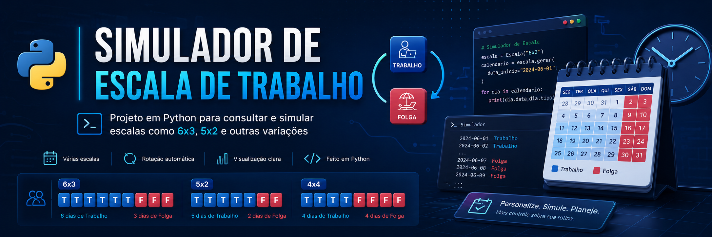
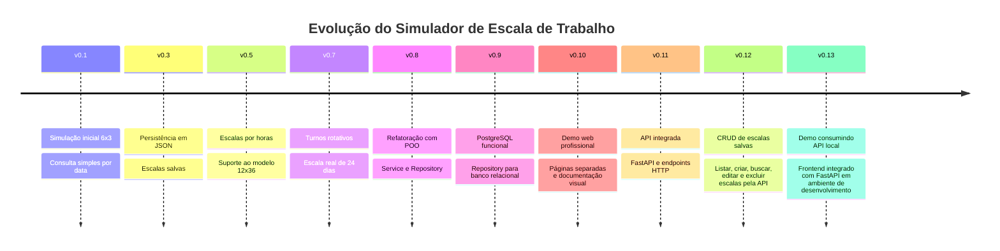
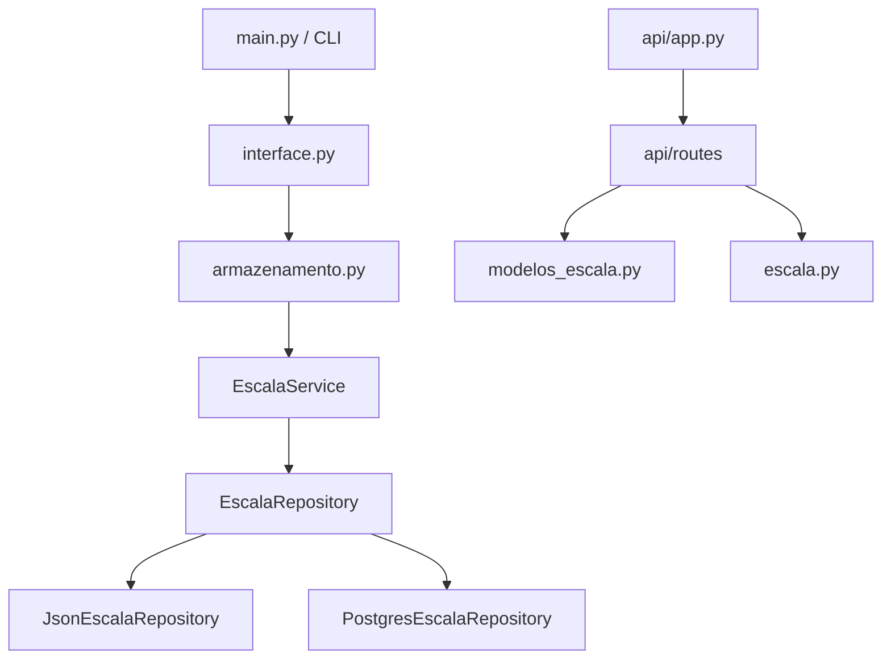
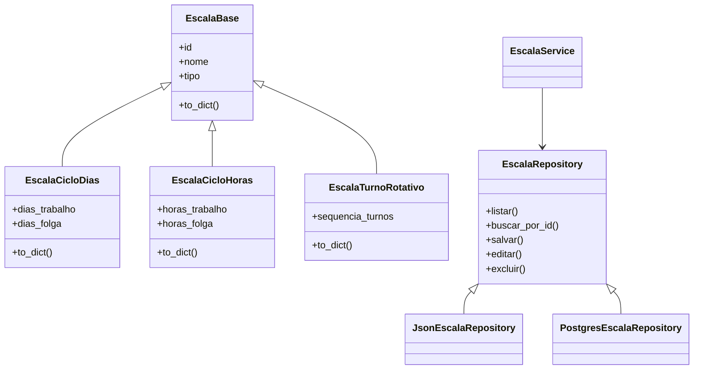
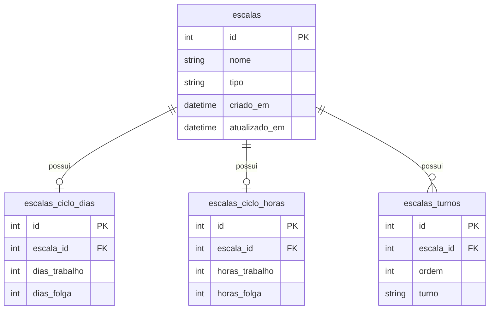

<p align="center">
  
</p>

<h1 align="center">⏰ Simulador de Escala de Trabalho</h1>

<p align="center">
  <strong>Aplicação em Python para consultar, simular, cadastrar, editar e excluir escalas de trabalho por dias, por horas e por turnos rotativos, com CLI, API em FastAPI integrada à demo, persistência em JSON/PostgreSQL, testes automatizados e arquitetura em camadas.</strong>
</p>

<p align="center">
  
</p>

<p align="center">
  
  
  
  
  
  
  
  
  
</p>

<p align="center">
  <a href="https://dinox75.github.io/simulador-escala-trabalho/demo/" target="_blank">
    
  </a>
</p>

<p align="center">
  <a href="#-sobre-o-projeto">Sobre</a> •
  <a href="#-versão-atual">Versão atual</a> •
  <a href="#-funcionalidades">Funcionalidades</a> •
  <a href="#-api">API</a> •
  <a href="#-arquitetura">Arquitetura</a> •
  <a href="#-persistência-json-e-postgresql">Persistência</a> •
  <a href="#-testes-automatizados">Testes</a> •
  <a href="#-como-executar-o-projeto">Executar</a> •
  <a href="#-roadmap">Roadmap</a>
</p>

---

<table>
  <tr>
    <td width="25%" align="center">
      <h3>📆 Escalas por dias</h3>
      <p>Modelos como 6x3, 5x2 e 4x2.</p>
    </td>
    <td width="25%" align="center">
      <h3>⏱️ Escalas por horas</h3>
      <p>Suporte para ciclos como 12x36.</p>
    </td>
    <td width="25%" align="center">
      <h3>🔄 Turno rotativo</h3>
      <p>Sequências manuais, por blocos e modelos prontos.</p>
    </td>
    <td width="25%" align="center">
      <h3>⚡ API integrada</h3>
      <p>Demo pública sem backend na v0.14.0.</p>
    </td>
  </tr>
</table>

---

## 📌 Sobre o projeto

O **Simulador de Escala de Trabalho** é uma aplicação criada para consultar, simular e organizar escalas de trabalho de forma simples, prática e evolutiva.

O projeto nasceu a partir de uma dúvida real:

> **“Hoje eu trabalho, folgo ou estou em qual turno?”**

A aplicação começou como um simulador de escala `6x3` no terminal, mas evoluiu para uma base mais completa, com suporte a:

- escalas por dias;
- escalas por horas;
- turnos rotativos;
- montagem de turnos por blocos;
- modelos predefinidos;
- escala real de 24 dias;
- cadastro, edição, exclusão e aplicação de escalas salvas;
- persistência em arquivo JSON;
- persistência alternativa em PostgreSQL;
- arquitetura com Programação Orientada a Objetos;
- camada de service;
- camada de repository;
- API integrada com FastAPI;
- testes automatizados;
- demo web interativa para apresentação do projeto.

O foco do projeto é transformar uma necessidade comum de consulta de escala em uma solução técnica organizada, testável e com potencial de evolução para produto.

---

## 🚀 Versão atual

**Versão:** `v0.14.0 - Simulação de escalas salvas e demo pública sem backend`

A demo pública em [GitHub Pages](https://dinox75.github.io/simulador-escala-trabalho/demo/) funciona sem instalar Python e sem iniciar a API. Modelos prontos e escalas personalizadas são calculados no navegador. Escalas criadas sem API ficam no `localStorage` daquele navegador e continuam disponíveis após recarregar a página. Esses dados não são enviados ao projeto.

Quando executada com a API local ativa, a demo usa os endpoints FastAPI e salva as escalas no repository configurado no backend. JSON em `data/escalas.json` é o padrão; PostgreSQL pode ser selecionado explicitamente com `ESCALA_REPOSITORY=postgres` e `POSTGRES_DSN`. As rotas de escrita recusam clientes remotos, mas a API não tem autenticação ou isolamento de usuários; mantenha-a em loopback e não publique operações compartilhadas de escrita.

### O que a v0.14.0 entrega

- CRUD e simulação de escalas salvas dos tipos `ciclo_dias`, `ciclo_horas` e `turno_rotativo` pela API.
- Modo de navegador para criar, listar, aplicar, simular, excluir e persistir escalas personalizadas sem backend.
- Indicação da origem dos dados: navegador ou API local.
- Status consultado na data escolhida; calendário e linha do tempo começam nessa data e calculam o ciclo a partir da data/hora inicial configurada.
- Calendário multi-mês e ciclos por horas que atravessam datas e meses.

### Primeira experiência

A origem pública do GitHub Pages funciona exclusivamente no navegador: ela não consulta `127.0.0.1`, não lê nem altera escalas da API local. Ao servir `docs/demo/` em `http://localhost` ou `http://127.0.0.1`, a demo oferece integração opcional com a API em `127.0.0.1:8000`; modelos e escalas indicam se os dados vêm da API local ou deste navegador. Ciclos personalizados aceitam até 120 dias ou horas no total, sequências rotativas até 60 posições e a linha do tempo até 60 dias.

1. Abra o [simulador público](https://dinox75.github.io/simulador-escala-trabalho/demo/simulador.html).
2. Escolha um modelo ou cadastre uma escala. Sem backend, a confirmação informa que ela ficou salva neste navegador.
3. Aplique a escala, escolha data inicial, data consultada e quantidade do período, e clique em simular.
4. Atualize a página para confirmar que a escala local continua na lista. O armazenamento é específico do navegador/dispositivo.

### Executar localmente e testar

```powershell
py -3 -m venv .venv
.\.venv\Scripts\Activate.ps1
python -m pip install -r requirements.txt
python -m pytest
uvicorn api.app:app --host 127.0.0.1 --port 8000 --reload
```

A API usa JSON por padrão e pode ser consultada em `http://127.0.0.1:8000/docs`. Sirva `docs/demo/` com uma extensão de servidor estático do VS Code ou equivalente e abra `simulador.html`. Se a API não estiver ativa, o modo local permanece disponível. Testes automatizados: `python -m pytest`; persistência PostgreSQL requer configuração e serviço próprios.

Consulte [documentação da API](docs/API.md) e [changelog](CHANGELOG.md) para detalhes e rotas.
## 📊 Linha de evolução



---

## 📌 Problema resolvido

Trabalhadores em escala frequentemente precisam consultar se determinado dia será de trabalho, folga ou qual turno será executado.

Esse problema fica mais evidente em escalas como:

- `6x3`;
- `5x2`;
- `4x2`;
- `12x36`;
- turnos rotativos;
- escalas com mudanças entre manhã, tarde, noite e folga.

A consulta manual em papel, planilhas ou memória pode gerar confusão, principalmente quando existem ciclos longos, virada de mês ou troca de turno.

---

## ✅ Solução proposta

O projeto permite informar uma escala, uma data inicial e uma data de consulta para descobrir automaticamente o status daquele dia.

A solução foi evoluindo em camadas:

1. **CLI em Python** para uso direto no terminal.
2. **Modelos predefinidos** para facilitar simulações comuns.
3. **Persistência em JSON** para salvar escalas.
4. **Arquitetura com POO, Service e Repository** para organizar o código.
5. **PostgreSQL funcional** como alternativa de persistência.
6. **Demo web** para apresentação visual do projeto.
7. **API integrada com FastAPI** para expor funcionalidades via HTTP.

---

## 🎯 Funcionalidades

### Consulta de status

Permite consultar se uma pessoa estará trabalhando, folgando ou em determinado turno em uma data informada.

Exemplo:

```text
Data inicial: 01/07/2026
Data consultada: 07/07/2026
Escala: 6x3
Resultado: Folga
```

### Visualização de próximos dias ou períodos

Permite visualizar uma sequência futura da escala, facilitando o planejamento pessoal.

### Cadastro de escalas

Permite cadastrar escalas personalizadas para reutilização posterior.

### Edição de escalas

Permite alterar escalas salvas.

### Exclusão de escalas

Permite remover escalas que não serão mais utilizadas.

### Modelos predefinidos

Inclui modelos prontos para facilitar testes e uso inicial.

### Persistência

O projeto suporta:

- JSON como persistência padrão;
- PostgreSQL como persistência alternativa configurável.

### API integrada

A partir da `v0.11.0`, o projeto passa a expor funcionalidades por endpoints HTTP usando FastAPI.

---

## 🧩 Modelos predefinidos

### Modelos disponíveis

| Modelo | Tipo | Descrição |
|---|---|---|
| `6x3` | ciclo por dias | 6 dias de trabalho e 3 dias de folga |
| `5x2` | ciclo por dias | 5 dias de trabalho e 2 dias de folga |
| `4x2` | ciclo por dias | 4 dias de trabalho e 2 dias de folga |
| `12x36` | ciclo por horas | 12 horas de trabalho e 36 horas de folga |
| `turno_rotativo_simples` | turno rotativo | sequência rotativa definida manualmente |
| `escala_real_24_dias` | turno rotativo | modelo de escala real com sequência de 24 dias |

### Escala real de 24 dias

O projeto também inclui uma escala rotativa baseada em uma sequência real de turnos, usada para validar cenários mais próximos da rotina de trabalho.

---

## 🧠 Como a lógica funciona

### 🔁 Escalas por dias

A regra considera a diferença entre a data inicial e a data consultada.

```python
ciclo = dias_trabalho + dias_folga
posicao = dias_passados % ciclo
```

Se a posição dentro do ciclo estiver dentro dos dias de trabalho, o status será `Trabalhando`. Caso contrário, será `Folga`.

### ⏱️ Escalas por horas

Para escalas como `12x36`, o cálculo considera data e hora.

```python
ciclo = horas_trabalho + horas_folga
posicao = horas_passadas % ciclo
```

Se a posição estiver dentro das horas de trabalho, o status será `Trabalhando`. Caso contrário, será `Folga`.

### 🔄 Turno rotativo

Para turnos rotativos, o sistema percorre uma sequência de turnos.

Exemplo:

```text
Manhã → Manhã → Tarde → Tarde → Noite → Noite → Folga → Folga
```

A posição dentro da sequência define o turno retornado.

### 🧱 Montagem por blocos

O projeto também suporta montagem de turnos por blocos, reduzindo repetição na criação de sequências maiores.

---

## 🖥️ Menu principal da CLI

Exemplo da interface principal no terminal:

```text
==== SIMULADOR DE ESCALAS ====
Escala atual: 6x3 dias

1 - Consultar status
2 - Ver próximos dias/períodos
3 - Alterar escala
4 - Ver escalas salvas
5 - Cadastrar nova escala
6 - Editar escala salva
7 - Excluir escala salva
8 - Sair

Escolha uma opção:
```

---

## ⚡ API

```text
v0.14.0 - Simulação de escalas salvas
```

A versão `v0.14.0` adiciona simulação de escalas salvas por nome. A demo pública também funciona sem API, usando armazenamento do navegador para escalas personalizadas.

A demo agora consome a API para:

- verificar se o backend está online;
- carregar modelos prontos;
- listar escalas salvas;
- criar novas escalas salvas;
- excluir escalas salvas;
- simular modelos prontos;
- simular escalas salvas por nome nos tipos ciclo por dias, ciclo por horas e turno rotativo;
- exibir próximos dias em linha do tempo e calendário.

Sem API, os cadastros ficam no navegador. Com a API ativa, JSON em `data/escalas.json` é o padrão; PostgreSQL exige seleção explícita por `ESCALA_REPOSITORY` e `POSTGRES_DSN`.

---

### Executar API FastAPI

A API foi desenvolvida com **FastAPI** e permite consumir funcionalidades do simulador por meio de requisições HTTP.

### Executar a API localmente

```powershell
uvicorn api.app:app --host 127.0.0.1 --port 8000 --reload
```

Depois acesse:

```text
http://127.0.0.1:8000/docs
```

### Endpoints principais

| Método   | Endpoint                          | Descrição                                   |
| -------- | --------------------------------- | ------------------------------------------- |
| `GET`    | `/health`                         | Verifica se a API está funcionando          |
| `GET`    | `/api/v1/modelos`                 | Lista modelos de escala disponíveis         |
| `POST`   | `/api/v1/simulacao/status`        | Consulta o status de uma escala em uma data |
| `POST`   | `/api/v1/simulacao/proximos-dias` | Retorna próximos dias da escala             |
| `GET`    | `/api/v1/escalas`                 | Lista escalas salvas                        |
| `POST`   | `/api/v1/escalas`                 | Cria uma nova escala salva                  |
| `GET`    | `/api/v1/escalas/{nome}`          | Busca uma escala salva pelo nome            |
| `PUT`    | `/api/v1/escalas/{nome}`          | Edita uma escala salva pelo nome            |
| `DELETE` | `/api/v1/escalas/{nome}`          | Exclui uma escala salva pelo nome           |
| `POST`   | `/api/v1/escalas/{nome}/simulacao/status` | Consulta status de escala salva |
| `POST`   | `/api/v1/escalas/{nome}/simulacao/proximos-dias` | Consulta período a partir de `data_consulta` |

### Integração com a demo web

A demo web em `docs/demo/` funciona sem API e usa a API local em:

```text
http://127.0.0.1:8000
```

Para testar corretamente:

1. execute a API com `uvicorn api.app:app --host 127.0.0.1 --port 8000 --reload`;
2. abra a demo por um servidor local;
3. confira o card de status da API;
4. use os modelos prontos para simular;
5. teste criar, recarregar e excluir escalas salvas.

Sem API, escalas personalizadas ficam no armazenamento local do navegador. A API não possui autenticação ou isolamento por usuário; mantenha as operações de escrita locais.

---

## Evolução recente

### v0.14.0

* Demo pública com modo sem backend e armazenamento local no navegador.
* Simulação pela API de escalas salvas por nome nos três tipos.
* Período da linha do tempo iniciado na data consultada; APIs preservam compatibilidade quando o campo não é enviado.

### v0.13.0

* Demo web consumindo a API local.
* Configuração de CORS para permitir integração entre frontend e backend.
* Card de status da API na página do simulador.
* Modelos carregados pela rota `/api/v1/modelos`.
* Escalas salvas carregadas pela rota `/api/v1/escalas`.
* Cadastro de escalas salvas via interface web.
* Exclusão de escalas salvas via interface web.
* Simulação de modelos prontos via API.
* Requisições manuais atualizadas em `docs/api_requests.http`.
* Documentação da API atualizada.

### v0.12.0

* CRUD completo de escalas salvas pela API.
* Reaproveitamento da camada de serviço.
* Reaproveitamento da camada de repository.
* Testes automatizados para os novos endpoints.
* Documentação atualizada da API.
* Exemplos manuais em `docs/api_requests.http`.

### v0.11.0

* Estrutura inicial da API com FastAPI.
* Endpoint `/health`.
* Endpoint `/api/v1/modelos`.
* Endpoint `/api/v1/simulacao/status`.
* Endpoint `/api/v1/simulacao/proximos-dias`.
* Testes automatizados para a API.

### v0.10.0

* Demo web profissional.
* Páginas de apresentação, documentação, sobre e termos.
* Interface visual para portfólio.

### v0.9.0

* PostgreSQL funcional.
* Repository pattern aplicado.
* JSON preservado como persistência padrão.
* Testes automatizados protegendo a evolução.

## 🧱 Arquitetura

O projeto evoluiu para uma estrutura em camadas, separando responsabilidades e facilitando manutenção.



### Ideia principal

- A CLI continua funcionando como interface principal de terminal.
- A API adiciona uma nova forma de consumir parte das funcionalidades.
- A lógica de escala permanece separada da camada HTTP.
- A persistência continua desacoplada por repositories.

---

## 🧩 Arquitetura em camadas

| Camada | Responsabilidade |
|---|---|
| CLI | Interação com o usuário pelo terminal |
| API | Exposição de funcionalidades via HTTP |
| Models | Representação das escalas como objetos |
| Service | Regras de negócio relacionadas às escalas salvas |
| Repository | Contrato para persistência |
| JSON Repository | Persistência em arquivo JSON |
| PostgreSQL Repository | Persistência em banco relacional |
| Database | Conexão e schema PostgreSQL |
| Tests | Garantia de comportamento esperado |

---

## 🏛️ Diagrama das classes POO



---

## 🧱 Estrutura atual do projeto

```text
simulador-escala-trabalho/
├── .github/
│   └── workflows/
│       └── tests.yml
│
├── api/
│   ├── __init__.py
│   ├── app.py
│   └── routes/
│       ├── __init__.py
│       ├── health.py
│       ├── modelos.py
│       ├── simulacao.py
│       └── escalas.py
│
├── assets/
│   └── banner.png
│
├── config/
│   ├── __init__.py
│   └── database_config.py
│
├── data/
│   └── escalas.json
│
├── database/
│   ├── inicializar_postgres.py
│   ├── postgres_connection.py
│   └── schema_postgresql.sql
│
├── docs/
│   ├── API.md
│   ├── api_requests.http
│   └── demo/
│       ├── index.html
│       ├── simulador.html
│       ├── documentacao.html
│       ├── sobre.html
│       ├── termos.html
│       ├── script.js
│       └── style.css
│
├── models/
│   ├── __init__.py
│   ├── escala_base.py
│   ├── escala_ciclo_dias.py
│   ├── escala_ciclo_horas.py
│   ├── escala_factory.py
│   └── escala_turno_rotativo.py
│
├── repositories/
│   ├── escala_repository.py
│   ├── json_escala_repository.py
│   └── postgres_escala_repository.py
│
├── services/
│   ├── escala_service.py
│   └── escala_service_factory.py
│
├── tests/
│   ├── test_api_health.py
│   ├── test_api_modelos.py
│   ├── test_api_simulacao.py
│   ├── test_api_proximos_dias.py
│   ├── test_postgres_escala_repository.py
│   └── demais testes do projeto
│
├── armazenamento.py
├── escala.py
├── interface.py
├── main.py
├── modelos_escala.py
├── tipos_escala.py
├── validacoes.py
├── requirements.txt
└── README.md
```

---

## 💾 Persistência JSON e PostgreSQL

O projeto possui duas formas de persistência:

| Tipo | Status | Uso |
|---|---|---|
| JSON | Padrão | Execução simples e testes |
| PostgreSQL | Funcional | Persistência relacional configurável |

### JSON

O JSON continua sendo o padrão do projeto.

Isso permite executar o sistema sem precisar configurar banco de dados.

```powershell
python main.py
```

### PostgreSQL

`PostgresEscalaRepository` está implementado e pode ser selecionado explicitamente pelo terminal ou pela API. Sem `ESCALA_REPOSITORY`, ambos usam JSON. Para PostgreSQL, configure `ESCALA_REPOSITORY=postgres` e `POSTGRES_DSN`; a ausência ou falha dessa configuração é informada sem mudança automática de backend. A API controla uma conexão por requisição. Consulte `database/README.MD` para configuração e limites de segurança.

---

## 🐘 Schema PostgreSQL

O schema atual usa uma tabela principal e tabelas específicas por tipo de escala.

O backend JSON permanece padrão. O seletor `ESCALA_REPOSITORY=postgres` escolhe PostgreSQL no terminal e na API local, que abre e fecha uma conexão por requisição. Configure `POSTGRES_DSN` explicitamente; sem credenciais, o modo PostgreSQL falha claramente e não troca para JSON.

### Tabelas principais

| Tabela | Responsabilidade |
|---|---|
| `escalas` | Guarda dados comuns da escala |
| `escalas_ciclo_dias` | Guarda dados de escalas por dias |
| `escalas_ciclo_horas` | Guarda dados de escalas por horas |
| `escalas_turnos` | Guarda a sequência dos turnos rotativos |

### Visão geral



---

## 🌐 Demo interativa

A demo web está disponível em:

```text
https://dinox75.github.io/simulador-escala-trabalho/demo/
```

A demo possui páginas separadas para:

- início;
- simulador;
- comparador de duas escalas;
- relatório mensal com calendário, impressão, Excel e CSV;
- documentação;
- sobre;
- termos.

A demo pública funciona sem API para modelos prontos e escalas personalizadas. Sem backend, cadastros ficam no armazenamento do navegador e permanecem após recarregar.

Com a API FastAPI local ativa, a demo carrega e grava escalas no repository selecionado pelo backend (`data/escalas.json` por padrão; PostgreSQL se explicitamente configurado). A linha do tempo e o calendário começam na data consultada, usando a data inicial para calcular o ciclo.

O [comparador](https://dinox75.github.io/simulador-escala-trabalho/demo/comparador.html) coloca dois modelos ou duas escalas salvas no mesmo mês e horário de consulta. Cada lado mantém sua própria data inicial e configuração; os parâmetros podem ser ajustados só para a comparação sem cadastrar uma escala. O resumo conta datas em que cada lado está trabalhando no horário escolhido e datas em que ambos estão de folga nesse horário. Ele não estima dias inteiros nem horas trabalhadas. Em ciclos por horas, como 12x36, o detalhe também mostra os intervalos de trabalho e folga dentro da data selecionada.

O [relatório mensal](https://dinox75.github.io/simulador-escala-trabalho/demo/relatorio.html) reúne uma ou duas escalas, com parâmetros e inícios de ciclo independentes. O calendário é a prévia principal; a tabela detalhada permite conferir cada data. **Mês exibido** define o período, enquanto **Início do ciclo** ancora o cálculo. Se houver uma escala por horas, **Consultar situação às** define o instante observado em cada data; para escalas somente por dias, horário não é necessário. O resumo, a impressão, o XLSX e o CSV vêm dos mesmos registros. Em 12x36, o status no horário consultado pode mudar dentro do dia; os totais não estimam dias inteiros nem horas trabalhadas. Ajustes são temporários, e os botões **Ir para o mês do início** de A ou B mudam o período somente quando acionados.

**Baixar Excel (.xlsx)** cria uma planilha com calendário, legenda, resumo e uma aba de registros detalhados, com rótulos junto às cores. O arquivo é produzido no navegador por `docs/demo/report-xlsx.js`, um gravador pequeno e específico de XLSX/ZIP sem dependência externa ou chamada a serviço. **CSV sem formatação** contém os mesmos registros e metadados em UTF-8 com BOM e ponto e vírgula; dependendo da configuração regional do Excel, use a importação com separador `;` para distribuir as colunas. Textos de nomes são gravados como texto no XLSX e protegidos contra interpretação como fórmula no CSV. **Imprimir / salvar como PDF** usa o navegador e não requer biblioteca de PDF.

Na origem GitHub Pages, os modelos e escalas salvas vêm dos dados estáticos e do armazenamento daquele navegador; nenhuma rota da API local é consultada. No servidor estático local, a lista de escalas pode vir da API local quando ela estiver ativa. A API não tem autenticação nem isolamento por usuário e deve permanecer restrita ao uso local.

Para experimentar localmente, sirva `docs/demo/` por um servidor estático. Inicie opcionalmente a API somente em loopback com `uvicorn api.app:app --host 127.0.0.1 --port 8000`.

## 🧪 Testes automatizados

O projeto possui testes automatizados com `pytest` cobrindo:

- lógica de escalas;
- validações;
- models;
- factories;
- repositories;
- services;
- armazenamento;
- PostgreSQL repository;
- API FastAPI.

### Rodar todos os testes

```powershell
python -m pytest
```

### Rodar testes da API

```powershell
python -m pytest tests/test_api_escalas.py tests/test_api_escalas_simulacao.py tests/test_api_health.py tests/test_api_modelos.py tests/test_api_proximos_dias.py tests/test_api_simulacao.py
```

### Rodar testes do PostgreSQL

Os testes de integração PostgreSQL são ignorados por padrão. Para habilitá-los, crie e inicialize um banco dedicado chamado `simulador_escala_test`; nunca use banco de desenvolvimento ou produção. Os testes do repository usam nomes aleatórios; o teste de migração cria e remove um schema exclusivo com nome aleatório dentro desse banco de teste.

No PowerShell, configure uma DSN explícita para o banco de teste e execute:

```powershell
$env:TEST_POSTGRES_DSN = "host=localhost port=5432 dbname=simulador_escala_test user=postgres password=SUA_SENHA"
$env:POSTGRES_DSN = $env:TEST_POSTGRES_DSN
python -m database.inicializar_postgres
.\.venv\Scripts\python.exe -m pytest tests/test_postgres_escala_repository.py
```

Sem `TEST_POSTGRES_DSN`, os testes são ignorados. Se estiver configurada, erros de conexão, credenciais ou esquema fazem os testes falharem. A variável `TEST_POSTGRES_DSN` nunca é usada pelo backend normal.

### Prévia e migração JSON → PostgreSQL

O comando de migração é explícito. Sem `--apply`, valida o JSON e mostra quantas escalas de cada tipo seriam importadas, sem conectar ou gravar. Faça a prévia em uma cópia temporária:

```powershell
$copia = Join-Path $env:TEMP 'escalas-migracao-teste.json'
Copy-Item data/escalas.json $copia
python migrar_json_postgres.py --source $copia
```

Para testar a importação, `--apply` exige `TEST_POSTGRES_DSN` com nome de banco contendo `test`, schema já inicializado e nenhuma escala. A importação, validação de retorno e rollback são transacionais. O arquivo JSON de origem não muda. Não use `--apply` para banco de desenvolvimento ou produção. Mais detalhes em `database/README.MD`.

---

## ⚙️ GitHub Actions

O projeto utiliza GitHub Actions para executar a suíte de testes automaticamente.

O workflow executa os testes usando JSON como persistência padrão:

```yaml
ESCALA_REPOSITORY: json
```

Isso mantém o pipeline mais estável e evita dependência obrigatória de banco PostgreSQL no ambiente de CI.

---

## ▶️ Como executar o projeto

### 1. Clonar o repositório

```powershell
git clone https://github.com/Dinox75/simulador-escala-trabalho.git
```

### 2. Entrar na pasta

```powershell
cd simulador-escala-trabalho
```

### 3. Criar ambiente virtual

```powershell
python -m venv venv
```

### 4. Ativar ambiente virtual

No Windows PowerShell:

```powershell
.\venv\Scripts\Activate.ps1
```

No Windows CMD:

```cmd
venv\Scripts\activate
```

No Linux/Mac:

```bash
source venv/bin/activate
```

### 5. Instalar dependências

```powershell
pip install -r requirements.txt
```

### 6. Executar aplicação no terminal

```powershell
python main.py
```

### 7. Executar API local

```powershell
uvicorn api.app:app --host 127.0.0.1 --port 8000 --reload
```

Depois acesse:

```text
http://127.0.0.1:8000/docs
```

### 8. Executar testes

```powershell
python -m pytest
```

---

## 🐘 Como preparar o PostgreSQL

### 1. Criar o banco

No PostgreSQL, crie o banco:

```sql
CREATE DATABASE simulador_escala;
```

### 2. Configurar variáveis de ambiente

No PowerShell, configure as variáveis conforme seu ambiente local:

```powershell
$env:ESCALA_REPOSITORY="postgres"
$env:POSTGRES_DSN="host=127.0.0.1 port=5432 dbname=simulador_escala user=postgres password=SUA_SENHA_AQUI"
```

### 3. Inicializar tabelas

```powershell
python -m database.inicializar_postgres
```

### 4. Executar aplicação usando PostgreSQL

```powershell
python main.py
```

---

## 💾 Exemplo de escalas salvas

### JSON

```json
{
  "id": 1,
  "nome": "Escala 6x3",
  "tipo": "ciclo_dias",
  "dias_trabalho": 6,
  "dias_folga": 3
}
```

### PostgreSQL

`PostgresEscalaRepository` está implementado e pode ser selecionado explicitamente pelo terminal ou pela API. Sem `ESCALA_REPOSITORY`, ambos usam JSON. Para PostgreSQL, configure `ESCALA_REPOSITORY=postgres` e `POSTGRES_DSN`; a ausência ou falha dessa configuração é informada sem mudança automática de backend. A API controla uma conexão por requisição. Consulte `database/README.MD` para configuração e limites de segurança.

---

## 🏢 Visão de produto

O projeto tem potencial para evoluir para uma solução mais completa de gestão e consulta de escalas.

### 👤 Área do colaborador

Possíveis funcionalidades futuras:

- consultar escala individual;
- visualizar próximos turnos;
- acompanhar folgas;
- receber notificações;
- acessar calendário pessoal.

### 🏭 Área da empresa

Possíveis funcionalidades futuras:

- cadastrar colaboradores;
- vincular colaboradores a escalas;
- gerenciar escalas por equipe;
- consultar cobertura de turnos;
- ampliar relatórios para equipes e períodos adicionais.

---

## 🗺️ Roadmap

### Versões recentes

| Versão | Entrega principal |
|---|---|
| `v0.9.0` | PostgreSQL funcional |
| `v0.10.0` | Demo web profissional |
| `v0.11.0` | API integrada com FastAPI |
| `v0.12.0` | API com CRUD de escalas salvas |
| `v0.13.0` | Demo web consumindo API local |
| `v0.14.0` | Demo pública sem backend e simulação de escalas salvas |

### Próximas versões sugeridas

| Versão | Objetivo |
|---|---|
| `v0.15.0` | Usuários e login |
| `v1.0.0` | Primeira versão completa do sistema |

### Melhorias técnicas planejadas

- Criar schemas de request/response mais detalhados.
- Separar camada de serviços da API de forma mais explícita.
- Criar autenticação em versão futura.
- Preparar deploy da API.
- Evoluir testes de integração.
- Consumir uma API publicada em produção, não apenas API local.

### Melhorias de produto planejadas

- Área do colaborador.
- Área da empresa.
- Associação de escalas a colaboradores.
- Calendário mais completo.
- Relatórios empresariais e exportação consolidada de dados.
- Notificações.

## 🧭 Linha de evolução técnica

| Fase | Aprendizado aplicado |
|---|---|
| Simulador inicial | Funções, datas e lógica condicional |
| Persistência JSON | Leitura e escrita de arquivos |
| Modelos predefinidos | Organização de regras reutilizáveis |
| POO | Classes e responsabilidades |
| Service | Separação de regra de negócio |
| Repository | Desacoplamento da persistência |
| PostgreSQL | Banco relacional e SQL |
| Demo web | Apresentação visual e portfólio |
| API | Endpoints HTTP com FastAPI |
| Testes | Pytest e validação automatizada |
| GitHub Actions | Integração contínua |

---

## 🧠 Aprendizados aplicados

Durante a evolução do projeto foram praticados conceitos como:

- manipulação de datas;
- modularização;
- validação de entrada;
- Programação Orientada a Objetos;
- camada de service;
- repository pattern;
- persistência em JSON;
- integração com PostgreSQL;
- criação de API com FastAPI;
- testes automatizados com Pytest;
- documentação técnica;
- versionamento com Git e GitHub;
- GitHub Actions.

---

## 📚 Tecnologias usadas

- Python;
- FastAPI;
- Uvicorn;
- Pytest;
- HTTPX;
- JSON;
- PostgreSQL;
- psycopg2;
- HTML;
- CSS;
- JavaScript;
- Git;
- GitHub;
- GitHub Actions;
- GitHub Pages.

---

## Limitações atuais

- A demo pública não envia operações de escrita para uma API hospedada; sem API, os dados ficam no armazenamento local daquele navegador.
- A API não possui autenticação nem isolamento por usuário; use-a apenas localmente.
- Não há login, colaboradores, férias, gestão empresarial ou migrations versionadas.
- Regras de feriados, trocas, afastamentos e exceções operacionais não fazem parte do cálculo.

## Status da v0.14.0

A v0.14.0 inclui simulação de escalas salvas por nome pela API para os três tipos e modo público sem backend. O modo público mantém escalas personalizadas no armazenamento do navegador após recarregar a página.

## 📄 Licença

Este projeto está sob licença MIT.

---

## 👨‍💻 Autor

Desenvolvido por **Vinicius Lima**.

GitHub:

```text
https://github.com/Dinox75
```

LinkedIn:

```text
https://www.linkedin.com/in/vinicius-limajr/
```

---

<p align="center">
  <strong>Projeto em evolução contínua 🚀</strong>
</p>
